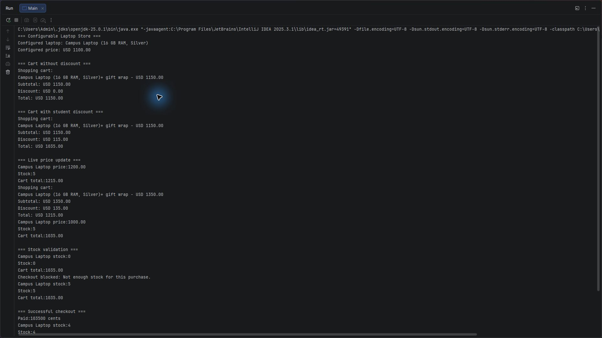
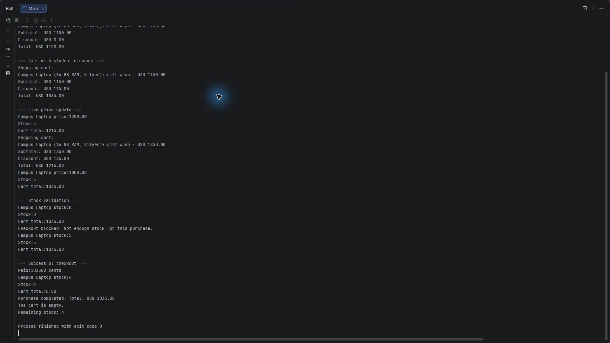

# E-Commerce Shopping Cart

A Java console application for the Software Design Patterns final project by **Abilmansur** and **Miras**. It demonstrates six distinct design patterns working together in one shopping scenario.

## Introduction

The application configures a laptop, adds gift wrapping, applies a student discount and completes a simulated purchase. Price and stock changes notify the cart observer immediately. The project uses plain Java and keeps all data in memory.

`Main` runs a fixed demonstration from start to finish; no keyboard input is required. Each run starts with a new product, a price of USD 1000.00 and five units in stock.

## Team contributions

| Student | Individually implemented patterns | Main responsibilities |
| --- | --- | --- |
| Abilmansur (A) | Builder, Strategy, Facade | Laptop configuration, cart and discounts, checkout facade, initial Main and ChecksA |
| Miras (B) | Observer, Decorator, Adapter | Product notifications, cart observer, gift wrapping, payment adapter and ChecksB; live-update scenario in Main |

The shared interfaces connect both contributions. The final Main uses the implementations from both students.

## Design patterns

| Pattern | Classes | Role in the application |
| --- | --- | --- |
| Builder | Laptop, Laptop.Builder | Builds a laptop with RAM 8 or 16 GB and Black or Silver color. Defaults are 8 GB and Black; unsupported options are rejected. |
| Strategy | DiscountStrategy, NoDiscount, StudentDiscount, ShoppingCart | Switches between no discount and a 10% student discount without changing the cart. |
| Facade | ShopFacade | Provides addProduct, setDiscount, showCart and checkout. It validates the cart and stock, calls payment, clears the cart and updates stock. |
| Observer | ProductInfo, ShopObserver, CartObserver | Notifies subscribers when the base price or stock changes. CartObserver prints the message, stock and current cart total. |
| Decorator | Product, ProductDecorator, GiftWrapDecorator | Wraps a laptop, preserves its ID, adds gift wrapping to its description and adds USD 50.00 to its price. |
| Adapter | PaymentProcessor, PaymentAdapter, OldPaymentSystem | Adapts pay(BigDecimal) to payInCents(long), converting USD 1035.00 into exactly 103500 cents. |

### How the patterns work together

Builder creates the laptop from a shared ProductInfo. GiftWrapDecorator wraps that same laptop, and ShoppingCart stores it through the Product interface. The selected discount strategy calculates the total. ProductInfo notifies CartObserver about price and stock updates. ShopFacade coordinates checkout and pays through PaymentAdapter.

Laptop reads the current base price from ProductInfo, so a price change also affects an item already in the cart. Its chosen RAM and color stay unchanged. Money uses BigDecimal; StudentDiscount rounds to two decimal places with HALF_UP.

## Requirements

- JDK 17 or later, with java and javac available on PATH for command-line use.
- IntelliJ IDEA is optional. The application was also run successfully in IntelliJ with OpenJDK 25.0.1.
- No external libraries or build tool are required. All Java files use the default package.

## Run in IntelliJ IDEA

1. Open the repository folder as a project.
2. Select an installed JDK in File > Project Structure > Project SDK.
3. If necessary, right-click src and select Mark Directory as > Sources Root.
4. Select Build > Build Project.
5. Open src/Main.java, click the green Run icon next to main and select Run Main.main().
6. Run src/ChecksA.java and src/ChecksB.java separately in the same way to execute both students' checks.

## Run from the command line

Open a terminal in the repository root. This command compiles the three entry points and their dependencies into out:

```sh
javac -encoding UTF-8 -d out -sourcepath src src/Main.java src/ChecksA.java src/ChecksB.java
java -cp out Main
```

Run both sets of checks after compilation:

```sh
java -cp out ChecksA
java -cp out ChecksB
```

## Demonstration and expected results

| Step | Expected result |
| --- | --- |
| Configure RAM 16 GB, Silver | Base 1000.00 + RAM upgrade 100.00 = USD 1100.00 |
| Add gift wrapping | Cart subtotal becomes USD 1150.00 |
| Apply the student discount | Discount is USD 115.00; total is USD 1035.00 |
| Change the base price to 1200.00 | Observer prints the update; subtotal becomes 1350.00 and total becomes 1215.00 |
| Restore the base price to 1000.00 | Cart total returns to USD 1035.00 |
| Set stock to 0 and attempt checkout | Checkout is blocked before payment; the item stays in the cart |
| Restore stock to 5 and check out | Adapter pays 103500 cents; stock becomes 4 and the cart is empty |

The blocked checkout is an expected demonstration of validation. Main catches that error and continues to the successful purchase.

## Application screenshots

These are actual screenshots of Main running in IntelliJ IDEA. Open an image to view it at full size.

### Configuration, gift wrapping and discount

The configured laptop costs USD 1100.00. Gift wrapping increases the subtotal to 1150.00, and the student strategy reduces the total to 1035.00.



### Observer updates, stock validation and checkout

The observer shows a total of 1215.00 after the price increase. The zero-stock checkout is blocked. After stock is restored, the adapter pays 103500 cents, the cart is cleared and four units remain.



## Checks

Both check programs use explicit AssertionError checks and need no JUnit or -ea flag. A failed check stops the program.

| Program | What it verifies | Success message |
| --- | --- | --- |
| ChecksA | Builder defaults and validation, immutable configuration, strategy switching, live prices and rounding, successful checkout, empty-cart and insufficient-stock guards | All A checks passed. |
| ChecksB | Gift-wrap price and preserved ID, observer subscription and removal, live cart price changes, exact payment conversion and rejection of zero/negative amounts | all B checks passed. |

ChecksA uses a recording payment implementation to verify whether the facade called payment. ChecksB verifies the actual PaymentAdapter and OldPaymentSystem. Main demonstrates their integration with the facade. All three programs completed with exit code 0 during verification.

## Project files

| Files | Purpose |
| --- | --- |
| src/Product.java, src/Laptop.java | Product contract and configurable laptop with Builder |
| src/DiscountStrategy.java, src/NoDiscount.java, src/StudentDiscount.java | Discount strategies |
| src/ShoppingCart.java, src/ShopFacade.java | Cart operations and checkout coordination |
| src/ProductInfo.java, src/ShopObserver.java, src/CartObserver.java | Observable product data and notifications |
| src/ProductDecorator.java, src/GiftWrapDecorator.java | Product wrapping |
| src/PaymentProcessor.java, src/PaymentAdapter.java, src/OldPaymentSystem.java | Payment contract, adapter and simulated legacy payment system |
| src/Main.java | Combined demonstration of all six patterns |
| src/ChecksA.java, src/ChecksB.java | Checks for both students' implementations |
| docs/01-cart-discount.png, docs/02-observer-checkout.png | Actual application screenshots |
| README.md, .gitignore | Project guide and generated-file exclusions |

## Conclusion and further work

The project demonstrates six coordinated patterns in one small Java application. Each student contributes three patterns. The same configured, decorated product is discounted, observed and purchased through the facade and adapter.

The current scope is one laptop SKU with shared stock, an in-memory cart and simulated payment. Possible extensions include multiple products, quantities, more discounts, persistent storage and an interactive menu.

