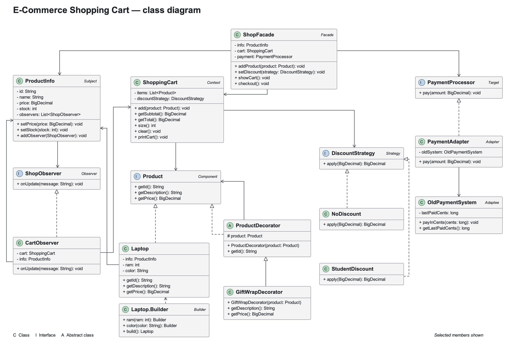
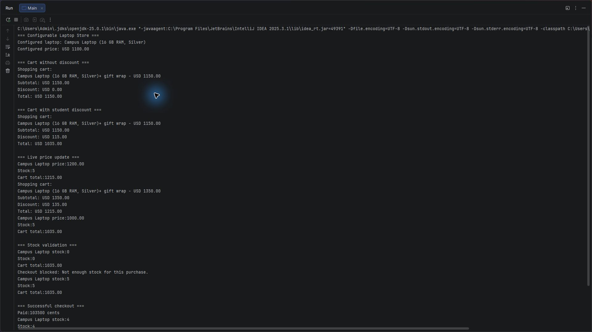
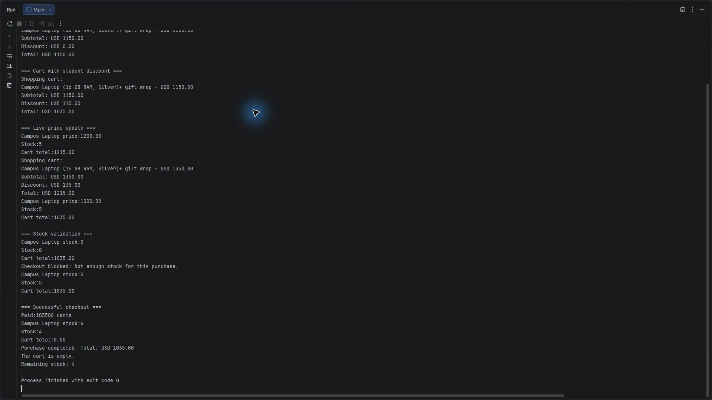

# Miras

## Observer

The laptop’s price or stock can change while it is in the cart. `ProductInfo` keeps a list of `ShopObserver` subscribers.

After `setPrice()` or `setStock()` saves a new value, it calls `notifyObservers()`, which passes the update to each subscriber through `onUpdate()`.

```java
for (ShopObserver observer : List.copyOf(observers)) {
    observer.onUpdate(message);
}
```

`CartObserver` reads the updated stock from `ProductInfo` and asks `ShoppingCart` for the current total. The laptop uses that same `ProductInfo` to get its base price, so the new price is included when the cart calculates the total.

## Decorator

`GiftWrapDecorator` wraps an existing `Product`. Its parent class, `ProductDecorator`, stores the original product and returns its ID.

The gift wrap adds a note to the description and charges USD 50.00 on top of the current price. Since the wrapper also implements `Product`, the cart accepts it the same way it accepts the laptop.

```java
@Override
public BigDecimal getPrice() {
    return product.getPrice().add(new BigDecimal("50.00"));
}
```

A laptop with 16 GB of RAM costs USD 1100.00. The wrapped version costs USD 1150.00 and uses the same product ID.

## Adapter

Checkout passes a `BigDecimal` amount to `PaymentProcessor`. `OldPaymentSystem` expects a `long` number of cents.

`PaymentAdapter` implements `PaymentProcessor` and converts the amount before calling the old system. It rejects zero, negative amounts and amounts that do not convert exactly to whole cents.

```java
cents = amount.movePointRight(2).longValueExact();
oldSystem.payInCents(cents);
```

For a purchase of USD 1035.00, `OldPaymentSystem` receives 103500 cents.

## Shared purchase walkthrough

1. Use the Builder to create a laptop with **16 GB of RAM**. The RAM upgrade raises the base price from USD 1000.00 to USD 1100.00.
2. Add gift wrapping with `GiftWrapDecorator`, then add the wrapped laptop to the cart through `ShopFacade`. The subtotal is USD 1150.00. With the **10% student discount**, the total is USD 1035.00.
3. Change the base price to **USD 1200.00** and check the console. `CartObserver` prints the new total of USD 1215.00. Then set the base price back to USD 1000.00.
4. Set the stock to **zero** and try to check out. `ShopFacade` stops the purchase before calling the payment system. The laptop stays in the cart.
5. Set the stock back to **five** and try again. `PaymentAdapter` sends 103500 cents to the old payment system. `ShopFacade` clears the cart and reduces the stock to four.
## UML class diagram



## Console demo




## Further Work

The shop could track stock separately for each product ID. Before taking payment, checkout would check whether enough units of each product in the cart are available.